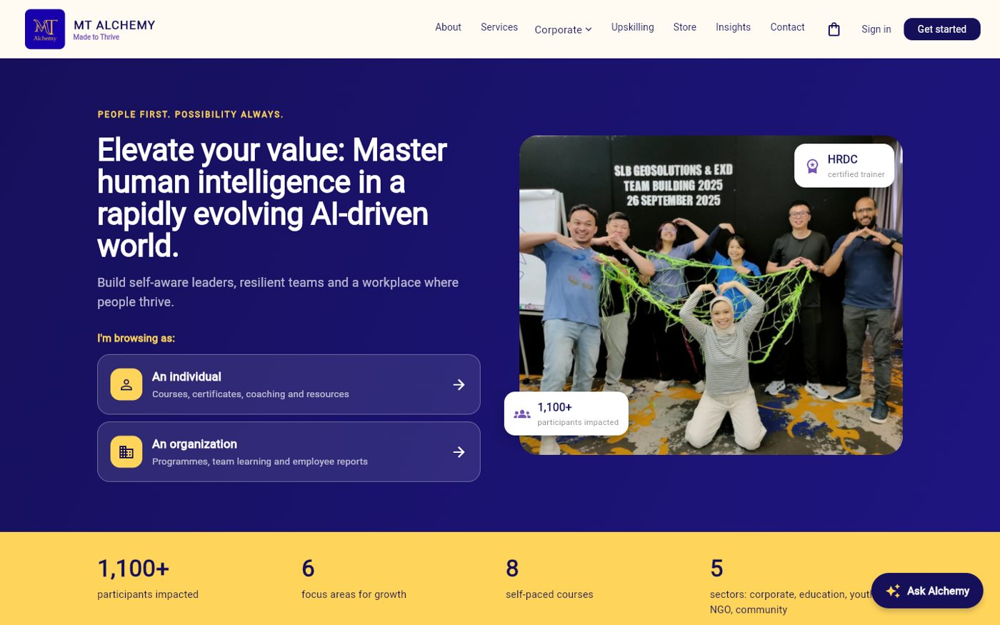
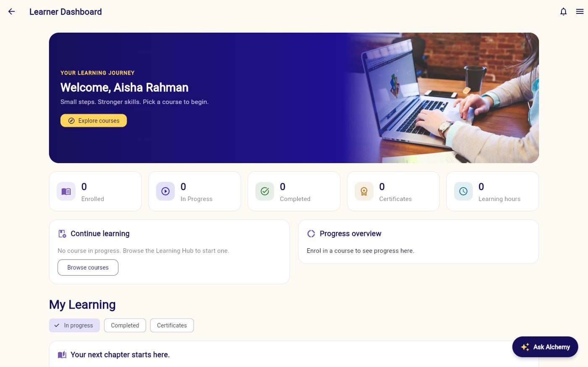
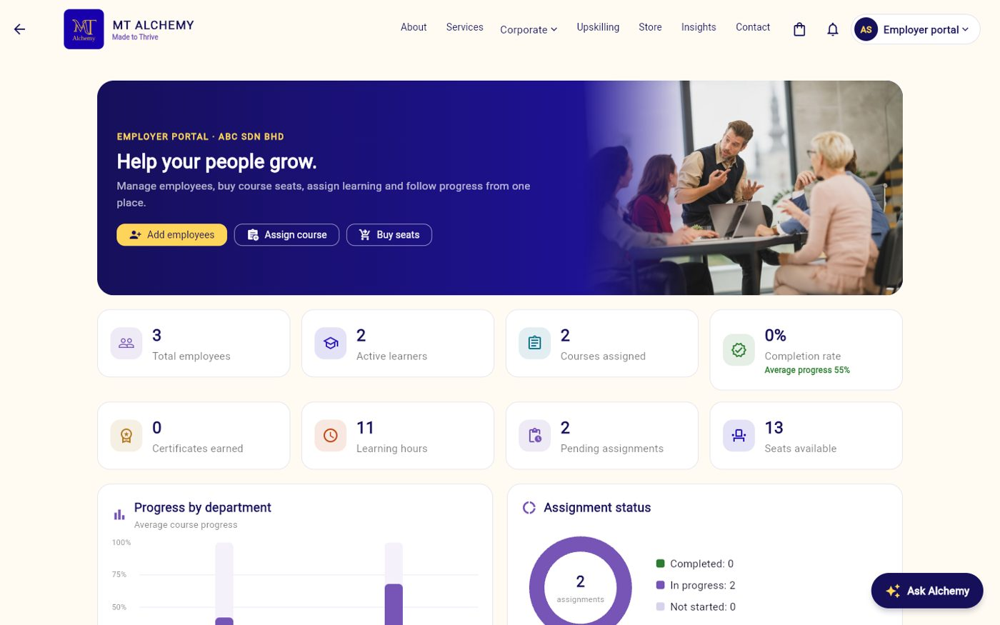
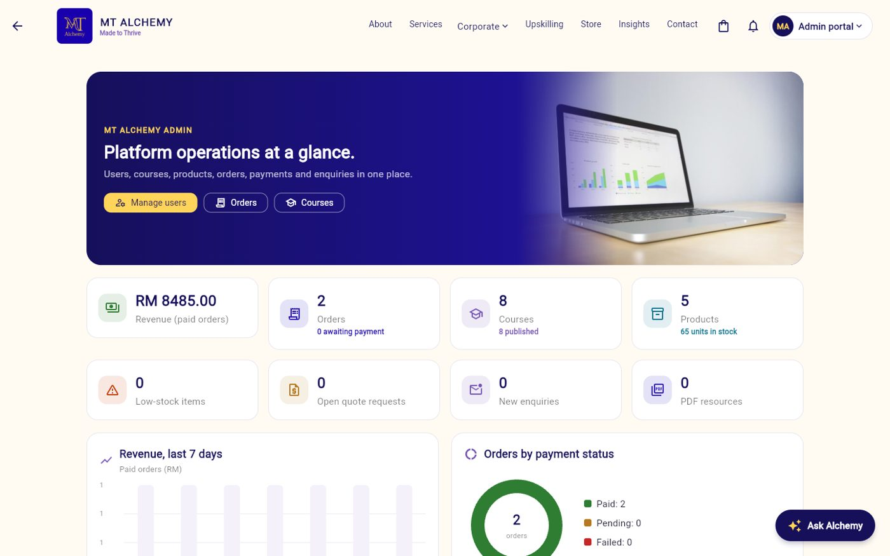
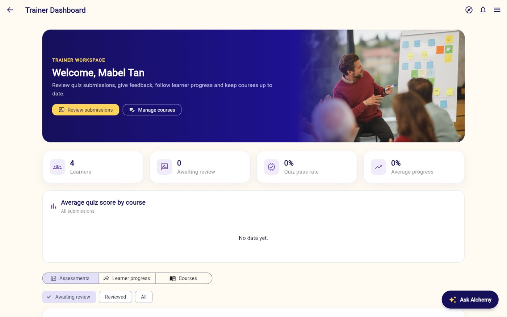
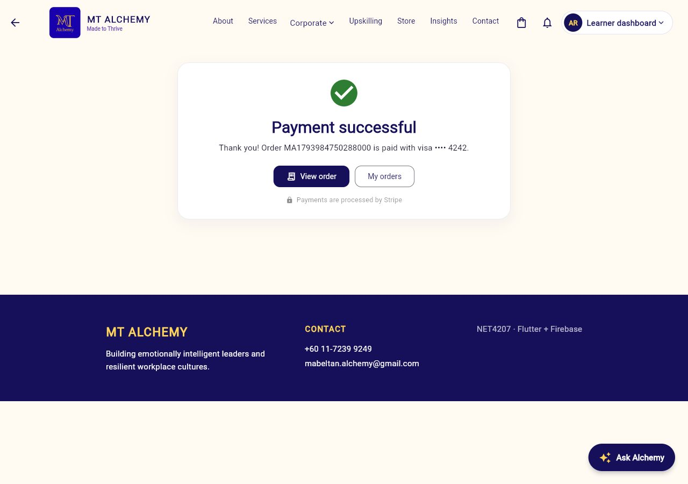
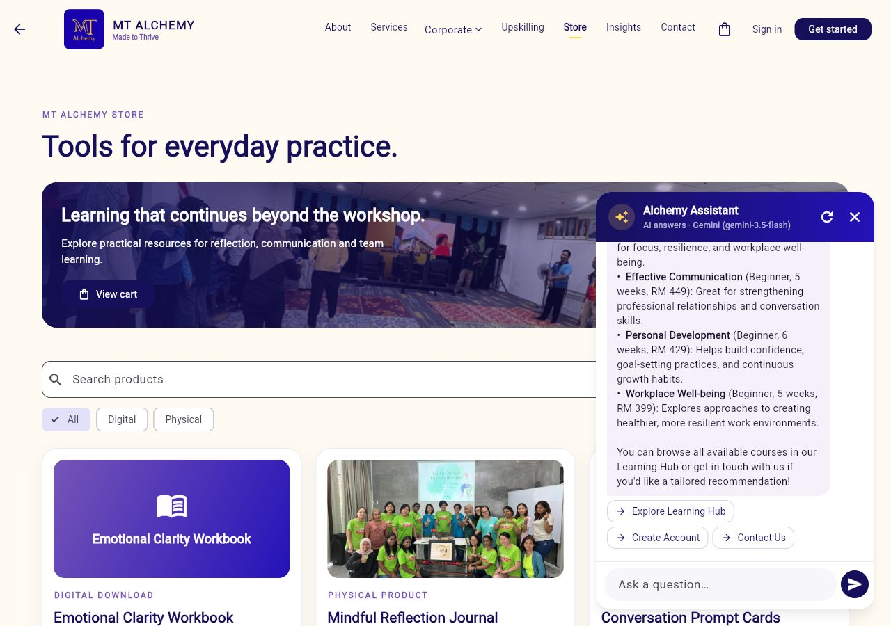
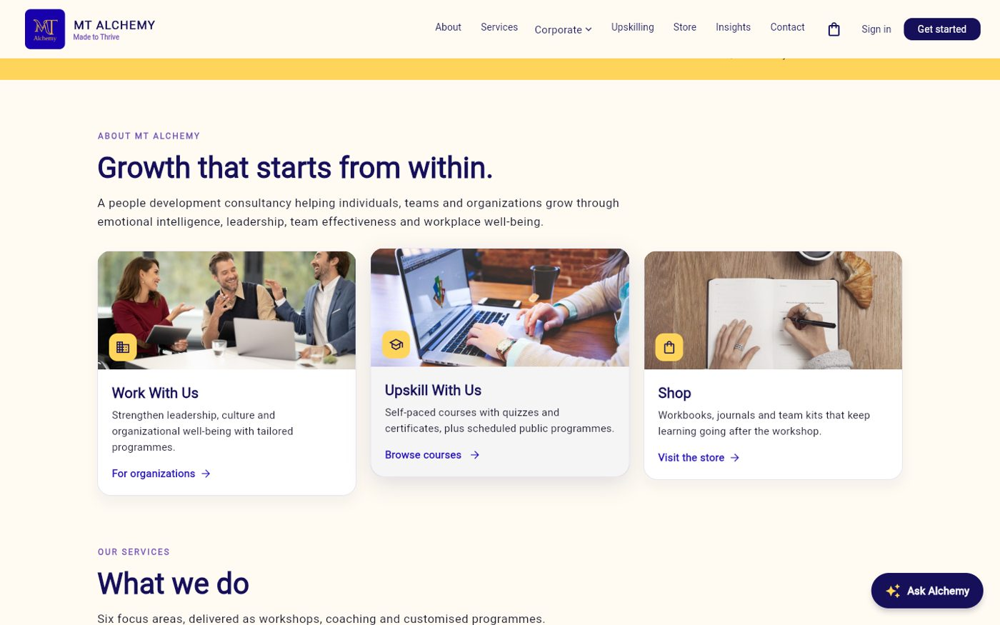
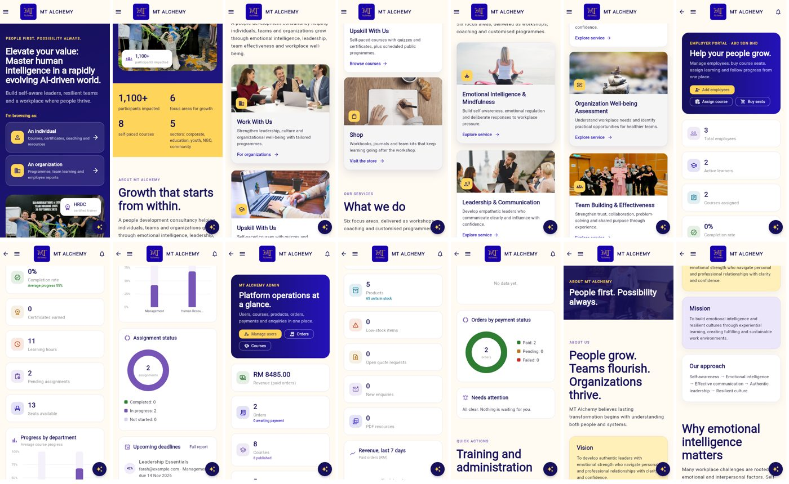

<div align="center">


# MT Alchemy

**Made to Thrive** · A people-development platform: corporate website, learning portal, online store and role-based workspaces.




</div>

---

## Table of contents

- [About](#about)
- [Features](#features)
- [Screenshots](#screenshots)
- [Tech stack](#tech-stack)
- [User roles](#user-roles)
- [User journeys](#user-journeys)
- [Getting started](#getting-started)
- [Configuration](#configuration)
- [Payments with Stripe](#payments-with-stripe)
- [AI assistant](#ai-assistant)
- [Data model and security](#data-model-and-security)
- [Testing](#testing)
- [Project structure](#project-structure)
- [Documentation](#documentation)
- [Credits](#credits)

## About

MT Alchemy is a people-development consultancy specialising in emotional intelligence, mindfulness, leadership, team effectiveness and workplace well-being. This Flutter web application brings its services online in one platform:

- a **corporate website** for individuals and organizations,
- a **Learning Management System** with lessons, quizzes and QR-verifiable certificates,
- an **e-commerce store** for digital and physical products,
- **workspaces** for learners, employers, trainers and administrators,
- an **AI assistant** that answers questions about courses, services and the store.

## Features

| Area | Highlights |
| --- | --- |
| Website | Separate homepages for individuals and organizations, services, coaching, corporate programmes with brochure PDFs, impact stories, insights, contact form |
| Learning | Course catalogue with Draft / Published / Archived status, paid enrolment, course player (Previous / Mark complete / Next), quizzes with pass marks, trainer feedback, certificates with QR verification |
| Store | Digital and physical products, cart, checkout with shipping, Stripe Checkout, order tracking, digital library |
| Employers | Bulk employee invites and course assignment from Excel/CSV, course seat purchases, progress charts by department, CSV/PDF reports, quotation requests |
| Trainers | Review quiz submissions, give feedback, follow learner progress, create and edit courses |
| Admins | Users and roles, organizations, courses, products and stock, orders and payments, quotes, enquiries, revenue and order charts |
| Everyone | Profiles with photo, in-app notifications, Gemini-powered assistant, responsive layout for desktop, tablet and phone |

## Screenshots

| Learner dashboard | Employer dashboard |
| --- | --- |
|  |  |
| **Admin dashboard** | **Trainer dashboard** |
|  |  |
| **Certificate with QR verification** | **Stripe payment confirmed** |
|  |  |
| **Alchemy Assistant (Gemini)** | **Homepage sections** |
|  |  |

<details>
<summary>Phone layout</summary>



</details>

## Tech stack

| Layer | Technology |
| --- | --- |
| App | Flutter (web, also builds for Android, iOS and desktop) |
| Authentication | Firebase Authentication (email and password) |
| Database | Cloud Firestore with live listeners and role-based security rules |
| Payments | Stripe Checkout through a small Node.js payment server (`payments_server/`) |
| AI | Google Gemini 3.5 Flash, with fallback to Gemini 3.1 Flash-Lite and built-in answers |
| Charts | fl_chart |
| Testing | flutter_test with an in-memory Firestore, Playwright end-to-end scripts |

## User roles

| Role | How the account is created | What they can do |
| --- | --- | --- |
| Visitor | No account | Browse the site, courses and store, add to cart, send an enquiry, chat with the assistant |
| Learner | Self-registration (Individual) | Buy courses, learn, take quizzes, earn certificates, shop, view orders and digital products |
| Employer | Self-registration (Organization) | Manage employees, buy course seats, assign courses, view reports, request quotes |
| Trainer | Created by an admin | Review quizzes, give feedback, follow learners, manage courses |
| Admin | Created by an admin | Full access: users, organizations, courses, products, orders, quotes, enquiries |

Only Learner and Employer accounts can be self-registered. Security rules prevent anyone from giving themselves the Trainer or Admin role.

<details>
<summary>Demo accounts (created by the seed script)</summary>

| Role | Email | Password |
| --- | --- | --- |
| Learner | learner@mtalchemy.demo | AlchemyLearner!26 |
| Trainer | trainer@mtalchemy.demo | AlchemyTrainer!26 |
| Employer | employer@mtalchemy.demo | AlchemyEmployer!26 |
| Admin | admin@mtalchemy.demo | AlchemyAdmin!26 |

The sign-in page shows one-tap chips for these accounts. Hide them with `SHOW_DEMO_ACCOUNTS=false`.

</details>

## User journeys

| Journey | Flow |
| --- | --- |
| **A. Individual learning** | Register → browse courses → pay → enrol → lessons → quiz → certificate (QR verified) |
| **B. Digital product** | Store → digital item → cart → checkout → payment → My Digital Products → download |
| **C. Physical product** | Store → cart → shipping address → payment → admin processes → Shipped → Delivered |
| **D. Employer** | Register organization → invite employees → buy seats → assign courses → employees learn → report |
| **E. Corporate enquiry** | Organizations → enquiry → admin inbox → consultation and quotation |

All five journeys are covered by automated browser tests in `e2e/`.

## Getting started

### Prerequisites

- [Flutter](https://docs.flutter.dev/get-started/install) 3.35 or newer
- [Node.js](https://nodejs.org) 18 or newer
- Firebase CLI: `npm install -g firebase-tools`
- Java 21 or newer (only for the local Firebase emulators)

### Quick start with local emulators (no cloud project needed)

```powershell
git clone https://github.com/sayyadsuzain9001/MT-Alchemy.git
cd MT-Alchemy
flutter pub get
powershell -ExecutionPolicy Bypass -File tool\dev.ps1
```

`tool\dev.ps1` starts the Firebase Auth and Firestore emulators, seeds demo data, starts the payment server (if configured) and runs the app in Chrome.

<details>
<summary>Manual steps</summary>

```powershell
firebase emulators:start --project demo-mtalchemy --only auth,firestore
cd firebase_seed; npm install; node seed.js --emulator; cd ..
flutter run -d chrome
```

Without a Firebase API key the app connects to the local emulators automatically.

</details>

### Run against a Firebase project

1. Create a project at [console.firebase.google.com](https://console.firebase.google.com) (the free Spark plan is enough).
2. Enable **Authentication → Email/Password** and create a **Firestore** database.
3. Add a **Web app** in Project settings and copy its config.
4. Copy `config/app_env.example.json` to `config/app_env.json` and fill in the values.
5. Deploy the security rules:
   ```powershell
   firebase deploy --only firestore:rules --project <project-id>
   ```
6. Seed demo accounts and data (signed in with `gcloud auth login` as a project owner):
   ```powershell
   cd firebase_seed; npm install; node seed_rest.js --project <project-id>
   ```
7. Run the app:
   ```powershell
   flutter run -d chrome --dart-define-from-file=config/app_env.json
   ```

## Configuration

All settings are passed at build time from `config/app_env.json` (git-ignored). See `config/app_env.example.json`.

| Key | Purpose |
| --- | --- |
| `FIREBASE_API_KEY`, `FIREBASE_PROJECT_ID`, `FIREBASE_APP_ID`, `FIREBASE_MESSAGING_SENDER_ID`, `FIREBASE_AUTH_DOMAIN`, `FIREBASE_STORAGE_BUCKET` | Firebase web app config. Leave the API key empty to use the emulators. |
| `GEMINI_API_KEY`, `GEMINI_MODEL` | AI assistant. Free key from [Google AI Studio](https://aistudio.google.com/app/apikey). |
| `PAYMENTS_API_URL` | URL of `payments_server` (e.g. `http://localhost:4242`). Empty = built-in test gateway. |
| `SHOW_DEMO_ACCOUNTS` | Show demo-account chips on the sign-in page. |

## Payments with Stripe

Card payments use **Stripe Checkout**. The Stripe secret key lives only in `payments_server/.env` (git-ignored) and never reaches the browser.

```powershell
cd payments_server
copy .env.example .env      # add your sk_test_... key
npm install
npm start                   # http://localhost:4242
```

During checkout choose **Card → Continue to Stripe**, pay with test card `4242 4242 4242 4242` (any future expiry and CVC), and you return to a confirmation page. The app confirms the payment with Stripe through the server before the order is marked **Paid**. A cancelled payment keeps the order **Pending** with a "Try payment again" button. FPX and bank transfer are also offered.

> For production: use live keys, host `payments_server` (for example on Cloud Run or Render), add the site to `ALLOWED_ORIGINS`, and confirm payments with a Stripe webhook.

## AI assistant

The **Alchemy Assistant** appears on every page. It is grounded on MT Alchemy's services, the live course catalogue, store products and the user's role, and it suggests buttons that open the right page. If the AI service is busy or not configured, it falls back to built-in answers.

> In a web app the Gemini key is visible to the browser. Restrict it in Google Cloud Console to the Generative Language API and your site's domain.

## Data model and security

| Collection | Contents | Access |
| --- | --- | --- |
| `users` | Profile and role | Owner; admins and trainers read; role cannot be self-changed |
| `products` | Store catalogue and stock | Public read; admin write |
| `courses`, `courseFiles` | Courses, quizzes, PDFs | Public read; admin and trainer write |
| `orders` | Orders, payments, shipping | Owner and admin |
| `progress`, `quizAttempts`, `certificates` | Learning records | Learner; trainers and admins read; certificates publicly verifiable |
| `employees`, `assignments` | Employer organization data | Owning employer and admin |
| `quotes`, `enquiries`, `notifications` | Requests and messages | Owner, recipient or admin |

Full entity-relationship diagram: [`docs/firestore_erd.md`](docs/firestore_erd.md). Rules: [`firestore.rules`](firestore.rules).

## Testing

```powershell
flutter analyze
flutter test
```

- **38 unit and widget tests** run against an in-memory Firestore.
- **End-to-end scripts** in `e2e/` (Playwright with Chrome) cover all five journeys, admin and trainer tools, profiles, navigation, Stripe Checkout and 23 security-rule checks.

## Project structure

```text
lib/
├── backend/       Firebase setup, auth gateway, Firestore sync
├── chat/          AI assistant service and chat UI
├── commerce/      Store, cart, checkout, Stripe, orders, quotes, course purchases
├── employer/      Employer workspace and bulk Excel/CSV import
├── admin/         Admin dashboard, users, products, orders, courses
├── screens/lms/   Learning hub, course player, quiz, certificates, dashboards
├── shared/        Sign-in, profiles, notifications, charts, UI kit
├── data/          Courses, progress and quiz attempts
├── pages.dart     Public website pages and routing
└── widgets.dart   Site shell, header and navigation
firebase_seed/     Demo data seed scripts
payments_server/   Stripe Checkout server (Node.js)
e2e/               Browser end-to-end tests
docs/              ERD, maintenance guide, screenshots, credits
```

## Documentation

- [Maintenance guide](docs/maintenance_guide.md): everyday admin tasks, configuration, payments, tests
- [Firestore ERD](docs/firestore_erd.md): data model
- [Image credits](docs/image_credits.md) and [stock photo credits](docs/stock_photo_credits.md)
- [Earlier coursework documents](docs/legacy/)

## Credits

- Company photos and content © MT Alchemy (Kaedae Event Management).
- Additional photography from [StockSnap](https://stocksnap.io), released under CC0.
- Built with Flutter, Firebase, Stripe and Google Gemini.
