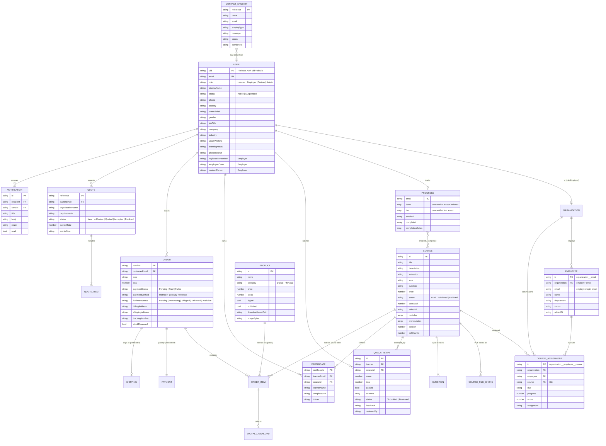

# MT Alchemy — Firestore data model (final ERD)

Cloud Firestore is a document database, so relationships are stored as keys (email or document id) instead of foreign-key constraints. Security rules in `firestore.rules` enforce who may read or write each relationship. The diagram shows the logical model; the table under it maps every entity to its collection.

## Entity → collection map

| Scope entity | Firestore location | Notes |
| --- | --- | --- |
| User, Role | `users/{uid}` | Role is a field; registration may only choose Learner or Employer. |
| Organization | `users/{uid}` with role `Employer` | Organization profile fields live on the employer account. |
| Employee | `employees/{org__email}` | Linked to a learner account by email. |
| Course, Module, Lesson | `courses/{id}` (`modules` array; lessons are generated per module) | PDFs chunked in `courseFiles/{id}/chunks/{n}`. |
| Assessment, Question, Answer | `courses/{id}.quiz`; answers in `quizAttempts/{id}.answers` | Trainer feedback on the attempt. |
| Enrolment, Progress | `progress/{email}` | Enrolment also derived from paid course orders and employer assignments. |
| Certificate | `certificates/{certificateId}` | Public read for QR verification. |
| Product, Product category | `products/{id}` (`category`) | Digital or Physical. |
| Cart | Browser storage (`alchemy_cart_v2`) | Guest carts work before sign-in. |
| Order, Order item, Payment, Shipping, Digital download | `orders/{number}` with embedded `lines`, payment and shipping fields | Digital download entitlement = paid order line. Course purchases are lines with category `Course`. |
| Quote | `quotes/{reference}` | Owner + admin only. |
| Notification | `notifications/{id}` | Sent by admin/trainer/employer; read by recipient. |
| Contact enquiry | `enquiries/{reference}` | Public create, admin read. |
| Review/Testimonial, Impact story, Article | Static content in `lib/pages.dart` | Candidates for a future `content` collection. |
